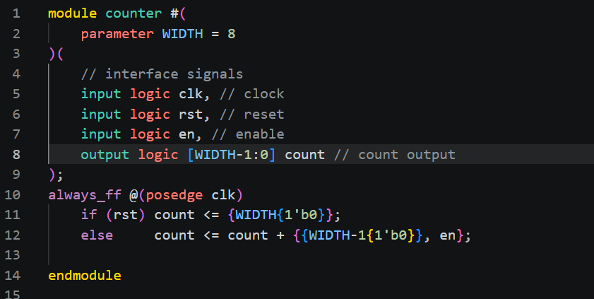
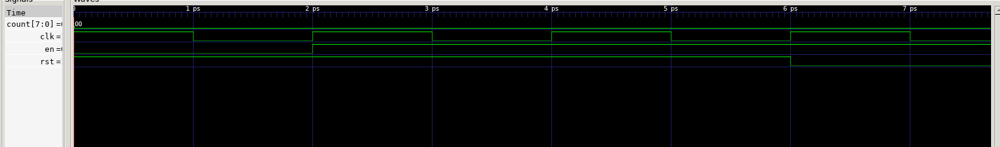
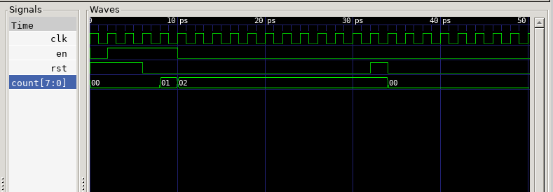

# Task 1 – Simulating a basic 8-bit binary counter

Files: `counter.sv` (design), `counter_tb.cpp` (testbench), `doit.sh` (build + run)

## The design

- `always_ff @(posedge clk)` makes a clocked register.
- `rst` is a **synchronous** reset: `count <= {WIDTH{1'b0}}` sets WIDTH zero bits on the next rising edge.
- Otherwise `count <= count + {{WIDTH-1{1'b0}}, en}`. The concatenation builds a WIDTH-bit number whose bottom bit is `en`, so the counter adds 1 when `en = 1` and adds 0 (holds) when `en = 0`.
- In hardware this is an adder feeding a 2-to-1 MUX (selected by `rst`) into a register, with the register output fed back to the adder.

## The testbench

- `Vcounter* top = new Vcounter;` creates the Verilator model of the counter (the device under test).
- `tfp->dump(2*i + clk)` writes signals to `counter.vcd` twice per cycle, so each clock period is 2 time units.
- Stimulus: `rst = (i<2) | (i==15)`, `en = (i<4)`.

## GTKWave results

Logbook observations:

- The clock has a 50% duty cycle, and one clock period = 2 ps.
- Cycles are counted from 0.
- `count` reaches **2** before `en` goes low. `en` is high for `i < 4` but `rst` is only low from `i > 2`, so the counter only gets two enabled rising edges.
- The counter resets at clock cycle 15 (shown at 16 because the testbench sets inputs after the clock edge, so they take effect on the next edge).
- The time axis shows **ps** only because `dump()` is given plain integer time steps and GTKWave's default unit is ps. Verilator is cycle-based, so the absolute unit doesn't matter.

## Challenges

- **Stop counting for 3 cycles at 0x9:** see [`challenge-pause-at-9/`](challenge-pause-at-9/).
- **Asynchronous reset** (`always_ff @(posedge clk, posedge rst)`): not recorded yet.
