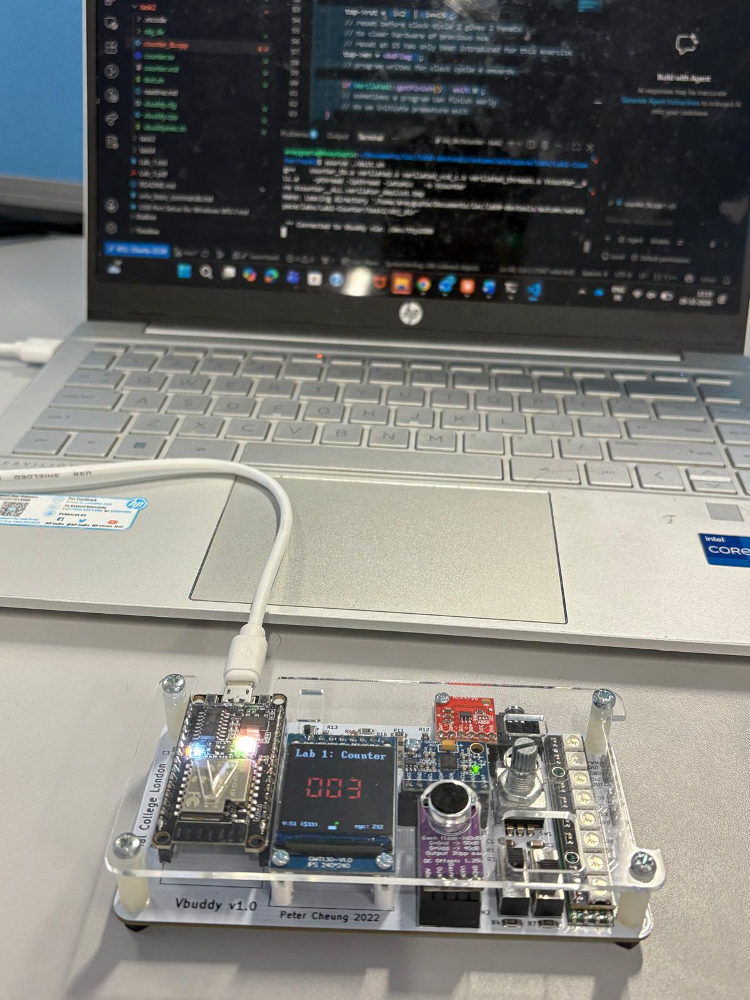

# Task 2 – Linking Verilator simulation with Vbuddy

Files: `counter.sv` (same as Task 1), `counter_tb.cpp`, `doit.sh`, plus links to `vbuddy.cpp` / `vbuddy.cfg`

## Setup

1. Attach Vbuddy to WSL: `~/Documents/iac/lab0-devtools/tools/attach_usb.sh`
2. Find the device: `ls /dev/ttyU*` gives `/dev/ttyUSB0`
3. Write the device name into `vbuddy.cfg`, ending with a newline

## Testbench changes

- `#include "vbuddy.cpp"` pulls in all the `vbdXxxx` functions.
- `vbdOpen()` reads the port from `vbuddy.cfg`, opens it at 115200 baud and clears the screen. `vbdHeader()` writes the title.
- Every cycle, the count is sent to the 7-segment displays and the cycle number is shown.
- `top->en = vbdFlag();`: the rotary encoder button toggles `en`, so it starts and stops the counter.
- `vbdClose()` at the end closes the port.

### Splitting count into hex digits

```cpp
vbdHex(4, (int(top->count) >> 12) & 0xF);
vbdHex(3, (int(top->count) >> 8)  & 0xF);
vbdHex(2, (int(top->count) >> 4)  & 0xF);
vbdHex(1,  int(top->count)        & 0xF);
```

The display has 4 hex digits (1 = right-most). Each shows 4 bits, so `>> n` moves the wanted nibble to the bottom and `& 0xF` (`1111`) masks off everything else. E.g. `count = 0xA7` shows `00A7`.

The lab handout uses `>> 16` for digit 4. It should be `>> 12` for bits 15:12, but this makes no difference for an 8-bit counter.

Each `vbdXxxx` call sends a text command over USB and waits for an acknowledgement, which is why the hex display runs slowly.

## Results



- The counter only moves while the flag is 1.
- The run stopped at **0x8F** (143) after 300 cycles. The count = the number of enabled cycles since the last reset (at cycle 15), wrapped to 8 bits.
- `(i==15)` resets **once at cycle 15**, not whenever count is 15. To wrap at 15 you would use `top->rst = (i<2) | (top->count == 15);`.

## Variations

- [`plot/`](plot/): `vbdPlot()` instead of the hex displays
- [`challenge-up-down/`](challenge-up-down/): `en` controls direction
