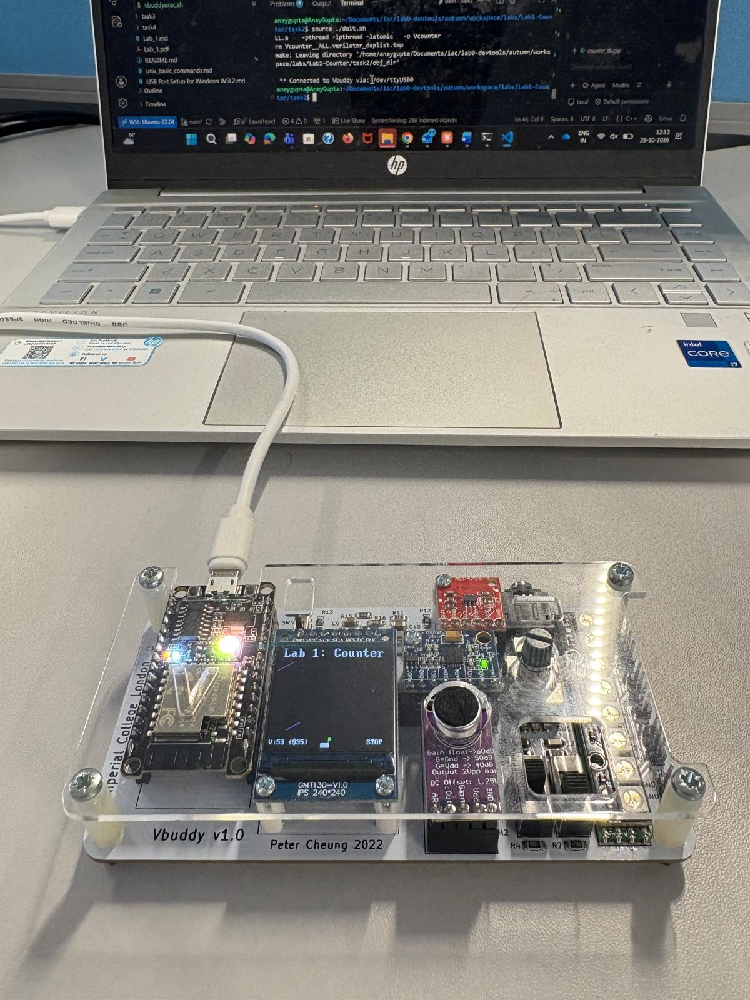

# Task 2 – plotting the count on the TFT

Same as [Task 2](../), but the four `vbdHex()` calls are replaced with:

```cpp
vbdPlot(int(top->count), 0, 255);
```

This plots one dot per cycle, with y scaled between 0 and 255. When x reaches 240 the screen clears and the plot starts again. Plotting is much faster than the 7-seg output (one message per cycle instead of four), so the cycle count can be increased. The button still starts and stops counting.


